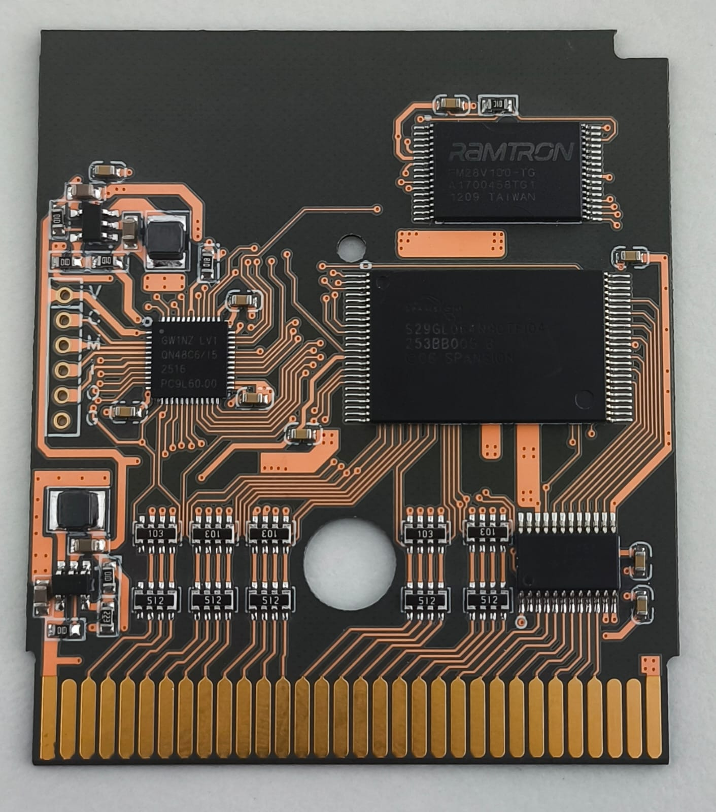
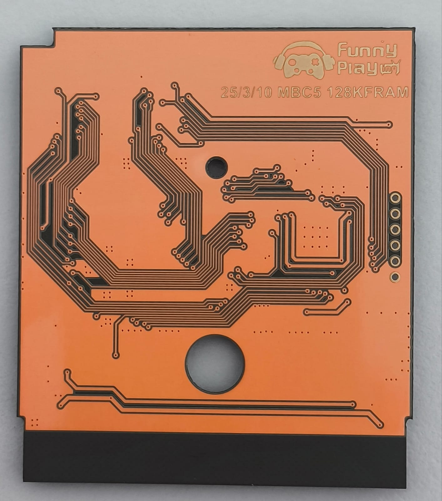
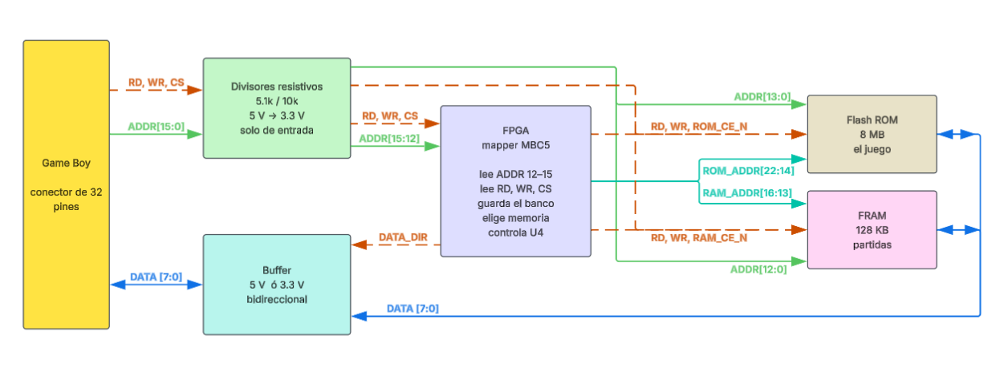
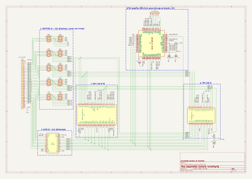

# Cartucho Game Boy / Game Boy Color con Controlador MBC5 (`FPGBC_cartucho`)

**Repositorio:** [digital-un-2026-2/FPGBC_cartucho](https://github.com/digital-un-2026-2/FPGBC_cartucho)  
**Asignatura:** Electrónica Digital - Universidad Nacional de Colombia (2026-2)  

---

# Integrantes

- **Juan Diego Rubiano Valero** - C.C. 1025525548
- **Pedro Nicolas Leguizamon Junco** - C.C. 1002587011
- **Juan José Rincón Monsalve** - C.C. 1053442496
- **Martín Rodríguez Galán** - C.C. 1013099753

---

## 📋 Tabla de Contenidos
1. [Descripción General](#descripción-general)
2. [Arquitectura y Diagrama de Bloques](#arquitectura-y-diagrama-de-bloques)
3. [El Controlador MBC5 (Memory Bank Controller 5)](#el-controlador-mbc5-memory-bank-controller-5)
   - [¿Qué es y por qué se utiliza?](#qué-es-y-por-qué-se-utiliza)
   - [Mapa de Memoria del Game Boy](#mapa-de-memoria-del-game-boy)
   - [Registros de Control del MBC5](#registros-de-control-del-mbc5)
4. [Análisis del Esquemático y Circuito](#análisis-del-esquemático-y-circuito)
   - [Adaptación de niveles de las líneas de dirección y control](#adaptación-de-niveles-de-las-líneas-de-dirección-y-control)
   - [Controlador MBC5 (FPGA)](#controlador-mbc5-fpga)
   - [ROM](#rom)
   - [FRAM](#fram)
   - [Conversor de nivel de voltaje bidireccional](#conversor-de-nivel-de-voltaje-bidireccional)
5. [Pinout Completo y Conexiones por Integrado](#pinout-completo-y-conexiones-por-integrado)
   - [Conector del Cartucho de 32 Pines](#1-conector-del-cartucho-de-32-pines)
   - [Memory Bank Controller MBC5 (FPGA)](#2-memory-bank-controller-mbc5-fpga)
   - [Memoria ROM](#3-memoria-rom)
   - [Memoria FRAM](#4-memoria-fram)
   - [Conversor de nivel de voltaje bidireccional](#5-conversor-de-nivel-de-voltaje-bidireccional)
   - [Divisores resistivos 5V → 3.3V](#6-divisores-resistivos-5v--33v)
   - [Conector de programación JTAG](#7-conector-de-programación-jtag)

---

## Descripción General

Esta sección del proyecto consiste en la recopilación y análisis del diseño de un cartucho compatible con las consolas **Game Boy** y **Game Boy Color (GBC)**, creado por la empresa FunnyPlaying bajo el nombre de [EverSave MBC5 GB/GBC Flash Cart 128KB](https://funnyplaying.com/products/eversave-mbc5-gb-gbc-flash-cart-副本).

  
   

El cartucho integra un controlador de bancos de memoria **MBC5 (Memory Bank Controller 5)** implementado en una **FPGA**, el cual permite direccionar hasta **64 Mbit (8 MB) de memoria ROM** y **1 Mbit (128 KB) de memoria FRAM** para el guardado permanente de partidas.

---

## Arquitectura y Diagrama de Bloques

El siguiente diagrama ilustra cómo se interconectan los bloques principales del cartucho, la dirección del flujo de datos y las señales de control entre el bus de la consola y los componentes integrados.

  

### Flujo de Datos y Señales

1. **Bus de Direcciones ($A_0 - A_{15}$):**
   - Las líneas de dirección de la consola (`GB_A0`..`GB_A15`) y las señales de control (`/RD`, `/WR`, `/CS`) pasan primero por divisores resistivos que las reducen de 5V a 3.3V (`ADDR_0`..`ADDR_15`, `RD`, `WR`, `CS`).
   - $A_0 - A_{13}$ llegan a la **ROM**. Como la ROM trabaja en modo byte, `ADDR_0` entra por el pin `DQ15/A-1` y `ADDR_1`..`ADDR_13` entran por `A0`..`A12`.
   - $A_0 - A_{12}$ se conectan directamente a la **FRAM** para direccionar los bloques de 8 KB de RAM.
   - $A_8$ y $A_{12} - A_{15}$ ingresan a la **FPGA**, que decodifica si la CPU está intentando acceder a la ROM, a la FRAM o escribir en los registros internos de control del MBC5.

2. **Bus de Datos ($D_0 - D_7$):**
   - Es bidireccional. Permite a la consola leer instrucciones de la ROM, leer/escribir datos en la FRAM y escribir valores de configuración en los registros del MBC5. Pasa por el conversor de nivel bidireccional (5V ↔ 3.3V).

3. **Líneas de Dirección Extendidas ($ROM_{14}..ROM_{22}$ y $RAM_{13}..RAM_{16}$):**
   - El MBC5 genera las líneas $ROM_{14} - ROM_{22}$ hacia la ROM para seleccionar el banco activo de hasta 512 bancos de 16 KB. Estas líneas entran a los pines `A13`..`A21` de la ROM, porque en modo byte cada pin de la ROM está desplazado un bit respecto al nombre de la señal (ver [Memoria ROM](#3-memoria-rom)).
   - El MBC5 genera las líneas $RAM_{13} - RAM_{16}$ hacia la FRAM para seleccionar el banco activo de RAM de hasta 16 bancos de 8 KB.

---

## El Controlador MBC5 (Memory Bank Controller 5)

### ¿Qué es y por qué se utiliza?

El procesador de 8 bits de la Game Boy (Sharp LR35902) posee un bus de direcciones de 16 bits, lo que limita su mapa de memoria total a **64 KB** (`0x0000` a `0xFFFF`), del cual destina únicamente **32 KB** (`0x0000` a  `0x7FFF`) para la ROM del cartucho y **8 KB** (`0xA000` a `0xBFFF`) para la FRAM externa.

Para poder ejecutar juegos complejos cuyos datos superan los 32 KB, se utiliza un circuito integrado llamado **MBC (Memory Bank Controller)**. El **MBC5** es la evolución final y más sólida de esta arquitectura. Los chips MBC utilizan la técnica de conmutación de bancos (*bank switching*): dividen la memoria del cartucho en bloques pequeños (bancos) y los intercambian dinámicamente en el mapa de memoria de la CPU a medida que el juego los necesita.

- **Soporte de hasta 8 MB de ROM:** Direccionamiento de hasta 512 bancos de 16 KB mediante 9 bits de selección ($ROM_{14} - ROM_{22}$).
- **Soporte de hasta 128 KB de FRAM:** Mapeo de hasta 16 bancos de 8 KB mediante 4 bits de selección ($RAM_{13} - RAM_{16}$).

### Mapa de Memoria del Game Boy

| Rango de Memoria | Tamaño | Descripción en un Cartucho MBC5 |
| :--- | :--- | :--- |
| `0x0000 - 0x3FFF` | 16 KB | **Banco 0 de ROM (Fijo):** Contiene el código principal y el vector de interrupciones. |
| `0x4000 - 0x7FFF` | 16 KB | **Banco $N$ de ROM (Conmutable):** Mapeado dinámicamente mediante las líneas $ROM_{14}..ROM_{22}$ del MBC5. |
| `0xA000 - 0xBFFF` | 8 KB | **Banco $M$ de FRAM (Conmutable/Opcional):** Mapeado mediante $RAM_{13}..RAM_{16}$ si la RAM está habilitada. |

### Registros de Control del MBC5

El MBC5 monitorea los ciclos de escritura de la consola en el rango de dirección de la ROM (`0x0000 - 0x7FFF`). Al escribir en estas direcciones, no se modifica la ROM, sino que se configuran los registros internos del MBC5:

1. **Habilitación de FRAM (`0x0000 - 0x1FFF`):**
   - Escribir `0x0A` habilita la lectura y escritura en la memoria FRAM.
   - Cualquier otro valor (como `0x00`) deshabilita la FRAM para proteger los datos de partida contra corrupción durante el apagado o fallos de lectura.

2. **Bits 0-7 del Banco de ROM (`0x2000 - 0x2FFF`):**
   - Escribir un valor de 8 bits selecciona los bits bajos del número de banco de ROM ($Bit_0 - Bit_7$).

3. **Bit 8 del Banco de ROM (`0x3000 - 0x3FFF`):**
   - Establece el noveno bit del banco de ROM (permite acceder a los bancos del 256 al 511).

4. **Número de Banco de FRAM (`0x4000 - 0x5FFF`):**
   - Escribir un valor de 4 bits (`0x0` a `0xF`) selecciona el banco activo de la memoria FRAM.

---

## Análisis del Esquemático y Circuito

El archivo esquemático `esquematico_cartucho.kicad_sch` fue desarrollado en **KiCad 9.0**. Corresponde al circuito del cartucho obtenido a través de ingeniería inversa realizada al módulo original. A continuación se detallan sus bloques funcionales:

  
   

### Adaptación de niveles de las líneas de dirección y control

- Las líneas de dirección (`GB_A0`..`GB_A15`) y de control (`GB_RD`, `GB_WR`, `GB_CS`) son solo de entrada, por lo que se adaptan de 5V a 3.3V con **divisores resistivos** formados por redes de resistencias `R_Pack04`: una resistencia en serie de **5.1 kΩ** (`RN1`, `RN3`, `RN5`, `RN7`, `RN9`) y una resistencia a tierra de **10 kΩ** (`RN2`, `RN4`, `RN6`, `RN8`, `RN10`).
- Con estos valores, una señal de 5V queda en aproximadamente 3.3V ($5 \cdot 10 / (5.1 + 10) \approx 3.31$ V).
- El bus de datos no usa divisores, porque es bidireccional: se adapta con el conversor de nivel `U4`.

### Controlador MBC5 (FPGA)

- **Entradas:** intercepta los buses de control `/RD`, `/WR`, `/CS` y las líneas de dirección $A_{12}, A_{13}, A_{14}, A_{15}$ para la decodificación de direcciones y registros. En el esquemático también llega $A_8$ (`ADDR_8`, pin 44).
- **Bidireccional:** el bus de datos `DATA_0`..`DATA_7`, para recibir los valores que la consola escribe en los registros.
- **Salidas:** `ROM_ADDR_14`..`ROM_ADDR_22`, `RAM_ADDR_13`..`RAM_ADDR_16`, `ROM_CE_N`, `RAM_CE_N` y `DATA_DIR`.
- La salida `RAM_CE_N` tiene una resistencia **pull-up de 10 kΩ a 3.3V** (`R2`), que mantiene el chip enable de la FRAM inactivo mientras la FPGA no maneja la línea.
- Los pines `T14A` y `T14B` (42 y 43) están unidos entre sí y a tierra a través de una resistencia de 1 kΩ (`R1`).
- Se programa por JTAG a través del conector `J2`.

### ROM

- Recibe las señales $A_0 - A_{13}$ del conector, ya adaptadas a 3.3V por los divisores. Por el modo byte, `ADDR_0` entra por `DQ15/A-1` y `ADDR_1`..`ADDR_13` entran por `A0`..`A12`.
- Recibe las señales $ROM_{14} - ROM_{22}$ generadas por el chip MBC5 (FPGA), que entran por `A13`..`A21`.
- La señal `/CE` (Chip Enable) de la ROM se conecta a la salida `ROM_CE_N` del MBC5.
- La señal `/OE` (Output Enable) se conecta directamente a la línea `RD` (`/RD` de la consola ya en 3.3V).
- La señal `/WE` se conecta a la línea `WR` (`/WR` de la consola ya en 3.3V).

### FRAM

- Recibe las señales $A_0 - A_{12}$ del conector, ya adaptadas a 3.3V por los divisores.
- Recibe las señales $RAM_{13} - RAM_{16}$ generadas por el chip MBC5 (FPGA).
- La señal `/CE1` (Chip Enable) de la FRAM se conecta a la salida `RAM_CE_N` del MBC5, y `CE2` está fija a 3.3V.
- La señal `/OE` (Output Enable) se conecta directamente a la línea `RD` y `/WE` a la línea `WR`.

### Conversor de nivel de voltaje bidireccional

- Integrado encargado de controlar la transmisión de datos de forma bidireccional y realizar la adaptación de niveles lógicos de 5V (consola) a 3.3V (memorias y FPGA).
- La señal `DIR` (Direction): Define el sentido del flujo de datos (de A hacia B, o de B hacia A). Está conectada a la salida `DATA_DIR` del MBC5.
- La señal `/OE` (Output Enable): Está conectada permanentemente a `GND` para mantener activo el canal de datos.

---

## Pinout Completo y Conexiones por Integrado

### 1. Conector del Cartucho de 32 Pines

| Pin | Nombre Señal | Tipo | Destino / Conexión |
| :---: | :--- | :---: | :--- |
| **1** | `VDD` | Power (+5V) | Riel principal de alimentación (+5V) |
| **2** | `NC` | - | No conectada |
| **3** | `/WR` | Entrada | Línea Write Enable del bus (`GB_WR`) |
| **4** | `/RD` | Entrada | Línea Read Enable del bus (`GB_RD`) |
| **5** | `/CS` | Entrada | Chip Select de RAM externa desde Game Boy (`GB_CS`) |
| **6..21** | `A0` .. `A15` | Entrada | Bus de direcciones de la consola (`GB_A0` .. `GB_A15`) |
| **22..29** | `D0` .. `D7` | Bidireccional | Bus de datos de la consola (`GB_D0` .. `GB_D7`) |
| **30** | `NC` | - | No conectada |
| **31** | `NC` | - | No conectada |
| **32** | `GND` | Power (GND) | Plano de tierra común del circuito |

---

### 2. Memory Bank Controller MBC5 (FPGA)

El controlador MBC5 está implementado en la FPGA **Gowin GW1NZ-LV1** (encapsulado QFN48, `U1`). Los nombres de pin son los del símbolo de KiCad.

| Pin | Nombre Pin FPGA | Tipo | Señal Conectada | Función / Descripción |
| :---: | :--- | :---: | :--- | :--- |
| **1** | `VCCIO0` | Power | `VCC_3.3` | Alimentación E/S Banco 0 (3.3V) |
| **2** | `GND` | Power | `GND` | Tierra |
| **3** | `T7B` | Entrada | `TCK` | Reloj JTAG de programación |
| **4** | `T7A` | Entrada | `TMS` | Selección de modo JTAG |
| **5** | `T8A` | Entrada | `TDI` | Entrada de datos JTAG |
| **6** | `T9A` | Salida | `RAM_ADDR_14` | Bit 14 de dirección extendida de RAM (→ FRAM A14) |
| **7** | `T8B` | Salida | `TDO` | Salida de datos JTAG |
| **8** | `T10B` | Salida | `RAM_ADDR_16` | Bit 16 de dirección extendida de RAM (→ FRAM A16) |
| **9** | `R2A` | Salida | `RAM_ADDR_15` | Bit 15 de dirección extendida de RAM (→ FRAM A15) |
| **10** | `R2B` | Salida | `RAM_ADDR_13` | Bit 13 de dirección extendida de RAM (→ FRAM A13) |
| **11** | `R3A` | Salida | `RAM_CE_N` | Chip Enable de la FRAM (→ `/CE1`, con pull-up R2 de 10k a 3.3V) |
| **12** | `VCC` | Power | `NC` | Marcado como no conectado en el esquemático |
| **13** | `R10B` | Entrada | `WR` | Señal `/WR` de la consola (reducida a 3.3V por divisor resistivo) |
| **14** | `R6B` | Entrada | `RD` | Señal `/RD` de la consola (reducida a 3.3V por divisor resistivo) |
| **15** | `R6D` | Entrada | `ADDR_12` | Bit A12 del bus de direcciones |
| **16** | `R6F` | Entrada | `ADDR_13` | Bit A13 del bus de direcciones |
| **17** | `R6G` | Entrada | `ADDR_14` | Bit A14 del bus de direcciones |
| **18** | `R6H` | Entrada | `ADDR_15` | Bit A15 del bus de direcciones |
| **19** | `R6J` | Salida | `DATA_DIR` | Control de dirección del transceptor (→ `DIR` de U4) |
| **20** | `R10A` | Salida | `ROM_CE_N` | Chip Enable de la ROM (→ `/CE`) |
| **21** | `R7B` | Bidireccional | `DATA_1` | Bit 1 del bus de datos (3.3V) |
| **22** | `R9A` | Bidireccional | `DATA_2` | Bit 2 del bus de datos (3.3V) |
| **23** | `R8B` | Bidireccional | `DATA_3` | Bit 3 del bus de datos (3.3V) |
| **24** | `R8A` | Bidireccional | `DATA_4` | Bit 4 del bus de datos (3.3V) |
| **25** | `VCCIO1` | Power | `VCC_3.3` | Alimentación E/S Banco 1 (3.3V), con desacople C1 |
| **26** | `GND` | Power | `GND` | Tierra |
| **27** | `R7A` | - | `NC` | No conectado |
| **28** | `R6I` | Bidireccional | `DATA_5` | Bit 5 del bus de datos (3.3V) |
| **29** | `R6E` | Bidireccional | `DATA_6` | Bit 6 del bus de datos (3.3V) |
| **30** | `R6C` | Bidireccional | `DATA_7` | Bit 7 del bus de datos (3.3V) |
| **31** | `R6A` | Salida | `ROM_ADDR_17` | Bit 17 de dirección extendida de ROM (→ ROM A16) |
| **32** | `R5B` | Entrada | `CS` | Señal `/CS` de la consola (reducida a 3.3V por divisor resistivo) |
| **33** | `R5A` | - | `NC` | No conectado |
| **34** | `R3B` | Salida | `ROM_ADDR_16` | Bit 16 de dirección extendida de ROM (→ ROM A15) |
| **35** | `T17B` | Salida | `ROM_ADDR_14` | Bit 14 de dirección extendida de ROM (→ ROM A13) |
| **36** | `VCCX` | Power | `VCC_3.3` | Alimentación auxiliar (3.3V) |
| **37** | `VCC` | Power | `VCC_1.2` | Alimentación del núcleo (1.2V), con desacople C2 y C3 |
| **38** | `T17A` | Salida | `ROM_ADDR_15` | Bit 15 de dirección extendida de ROM (→ ROM A14) |
| **39** | `T16B` | Salida | `ROM_ADDR_22` | Bit 22 de dirección extendida de ROM (→ ROM A21) |
| **40** | `T16A` | Salida | `ROM_ADDR_20` | Bit 20 de dirección extendida de ROM (→ ROM A19) |
| **41** | `T15B` | Salida | `ROM_ADDR_21` | Bit 21 de dirección extendida de ROM (→ ROM A20) |
| **42** | `T14B` | - | `GND` (vía R1 de 1k) | Unido al pin 43 y a tierra a través de R1 |
| **43** | `T14A` | - | `GND` (vía R1 de 1k) | Unido al pin 42 y a tierra a través de R1 |
| **44** | `T13A` | Entrada | `ADDR_8` | Bit A8 del bus de direcciones |
| **45** | `T12B` | Salida | `ROM_ADDR_19` | Bit 19 de dirección extendida de ROM (→ ROM A18) |
| **46** | `T12A` | - | `NC` | No conectado |
| **47** | `T10A` | Bidireccional | `DATA_0` | Bit 0 del bus de datos (3.3V) |
| **48** | `T9B` | Salida | `ROM_ADDR_18` | Bit 18 de dirección extendida de ROM (→ ROM A17) |

---

### 3. Memoria ROM

Memoria Flash NOR de 64 Mbit / 8 MB **S29GL064N90TFI04** (encapsulado TSOP-48, `U2`).

> **Nota sobre el modo byte:** con `/BYTE` a tierra, el pin `DQ15/A-1` funciona como el bit 0 de la dirección y `A0` como el bit 1. Por eso la señal `ADDR_n` / `ROM_ADDR_n` (bit $n$ de la dirección de byte) entra por el pin `A(n-1)` de la ROM.

| Pin | Nombre Señal ROM | Tipo | Conexión / Origen | Función / Descripción |
| :---: | :--- | :---: | :--- | :--- |
| **1** | `A15` | Entrada | `ROM_ADDR_16` | Bit 16 de dirección de ROM (desde MBC5) |
| **2** | `A14` | Entrada | `ROM_ADDR_15` | Bit 15 de dirección de ROM (desde MBC5) |
| **3** | `A13` | Entrada | `ROM_ADDR_14` | Bit 14 de dirección de ROM (desde MBC5) |
| **4..8** | `A12` .. `A8` | Entrada | `ADDR_13` .. `ADDR_9` | Bits A9 a A13 del bus de la consola (3.3V) |
| **9** | `A19` | Entrada | `ROM_ADDR_20` | Bit 20 de dirección de ROM (desde MBC5) |
| **10** | `A20` | Entrada | `ROM_ADDR_21` | Bit 21 de dirección de ROM (desde MBC5) |
| **11** | `/WE` | Entrada | `WR` | Write Enable (desde escritura de consola `/WR`) |
| **12** | `/RESET` | Entrada | `VCC_3.3` | Reset inactivo (pull-up a 3.3V) |
| **13** | `A21` | Entrada | `ROM_ADDR_22` | Bit 22 de dirección de ROM (desde MBC5) |
| **14** | `/WP/ACC` | Entrada | `VCC_3.3` | Protecciones por hardware desactivadas |
| **15** | `RY/BY#` | Salida | `NC` | Indicador Ready/Busy (No conectado) |
| **16** | `A18` | Entrada | `ROM_ADDR_19` | Bit 19 de dirección de ROM (desde MBC5) |
| **17** | `A17` | Entrada | `ROM_ADDR_18` | Bit 18 de dirección de ROM (desde MBC5) |
| **18..24** | `A7` .. `A1` | Entrada | `ADDR_8` .. `ADDR_2` | Bits A2 a A8 del bus de la consola (3.3V) |
| **25** | `A0` | Entrada | `ADDR_1` | Bit A1 del bus de la consola (3.3V) |
| **26** | `/CE` | Entrada | `ROM_CE_N` | Habilitación de Chip Enable (desde MBC5) |
| **27** | `VSS` | Power | `GND` | Tierra |
| **28** | `/OE` | Entrada | `RD` | Output Enable (desde lectura de consola `/RD`) |
| **29, 31, 33, 35** | `DQ0` .. `DQ3` | Bidireccional | `DATA_0` .. `DATA_3` | Bus de datos bits 0..3 (3.3V) |
| **30, 32, 34, 36** | `DQ8` .. `DQ11` | Bidireccional | `NC` | No utilizados en modo de 8 bits |
| **37** | `VCC` | Power | `VCC_3.3` | Alimentación principal (3.3V) |
| **38, 40, 42, 44** | `DQ4` .. `DQ7` | Bidireccional | `DATA_4` .. `DATA_7` | Bus de datos bits 4..7 (3.3V) |
| **39, 41, 43** | `DQ12` .. `DQ14` | Bidireccional | `NC` | No utilizados en modo de 8 bits |
| **45** | `DQ15/A-1` | Entrada | `ADDR_0` | Bit A0 del bus de la consola (A-1 en modo byte) |
| **46** | `VSS` | Power | `GND` | Tierra |
| **47** | `/BYTE` | Entrada | `GND` | Configura la memoria en modo de 8 bits (Byte Mode) |
| **48** | `A16` | Entrada | `ROM_ADDR_17` | Bit 17 de dirección de ROM (desde MBC5) |

---

### 4. Memoria FRAM

Memoria Ferroeléctrica de 1 Mbit / 128 KB **FM28V100-TG** (encapsulado TSOP-32, `U3`).

| Pin | Nombre Señal FRAM | Tipo | Conexión / Origen | Función / Descripción |
| :---: | :--- | :---: | :--- | :--- |
| **1** | `A11` | Entrada | `ADDR_11` | Bit A11 del bus de la consola (3.3V) |
| **2** | `A9` | Entrada | `ADDR_9` | Bit A9 del bus de la consola (3.3V) |
| **3** | `A8` | Entrada | `ADDR_8` | Bit A8 del bus de la consola (3.3V) |
| **4** | `A13` | Entrada | `RAM_ADDR_13` | Bit 13 de dirección extendida de RAM (desde MBC5) |
| **5** | `/WE` | Entrada | `WR` | Write Enable (desde escritura de consola `/WR`) |
| **6** | `CE2` | Entrada | `VCC_3.3` | Chip Enable 2 activo en alto |
| **7** | `A15` | Entrada | `RAM_ADDR_15` | Bit 15 de dirección extendida de RAM (desde MBC5) |
| **8** | `VDD` | Power | `VCC_3.3` | Alimentación principal (3.3V) |
| **9** | `NC` | - | `NC` | No conectado |
| **10** | `A16` | Entrada | `RAM_ADDR_16` | Bit 16 de dirección extendida de RAM (desde MBC5) |
| **11** | `A14` | Entrada | `RAM_ADDR_14` | Bit 14 de dirección extendida de RAM (desde MBC5) |
| **12..16** | `A12`, `A7`..`A4` | Entrada | `ADDR_12`, `ADDR_7`..`ADDR_4` | Bits de dirección del bus de la consola (3.3V) |
| **17..20** | `A3` .. `A0` | Entrada | `ADDR_3` .. `ADDR_0` | Bits A3 a A0 del bus de la consola (3.3V) |
| **21, 22, 23, 25** | `DQ0` .. `DQ3` | Bidireccional | `DATA_0` .. `DATA_3` | Bus de datos bits 0..3 (3.3V) |
| **24** | `VSS` | Power | `GND` | Tierra |
| **26..29** | `DQ4` .. `DQ7` | Bidireccional | `DATA_4` .. `DATA_7` | Bus de datos bits 4..7 (3.3V) |
| **30** | `/CE1` | Entrada | `RAM_CE_N` | Chip Enable 1 activo en bajo (desde MBC5) |
| **31** | `A10` | Entrada | `ADDR_10` | Bit A10 del bus de la consola (3.3V) |
| **32** | `/OE` | Entrada | `RD` | Output Enable (desde lectura de consola `/RD`) |

---

### 5. Conversor de nivel de voltaje bidireccional

Transceptor / Conversor de nivel bidireccional octal de 8 bits **LJ245A** (encapsulado TSSOP-24, `U4`).

| Pin | Nombre Pin | Tipo | Conexión / Señal | Función / Descripción |
| :---: | :--- | :---: | :--- | :--- |
| **1** | `VCCA` | Power | `VCC_5V` | Alimentación Lado A (referencia 5V consola) |
| **2** | `DIR` | Entrada | `DATA_DIR` | Control de dirección de datos (desde MBC5) |
| **3..10** | `A1` .. `A8` | Bidireccional | `GB_D0` .. `GB_D7` | Bus de datos de 5V (Lado consola Game Boy) |
| **11..13** | `GND` | Power | `GND` | Tierra común del circuito |
| **14..21** | `B8` .. `B1` | Bidireccional | `DATA_7` .. `DATA_0` | Bus de datos de 3.3V (Lado interno memorias/FPGA) |
| **22** | `/OE` | Entrada | `GND` | Output Enable habilitado permanentemente |
| **23, 24** | `VCCB` | Power | `VCC_3.3` | Alimentación Lado B (referencia 3.3V interno) |

---
